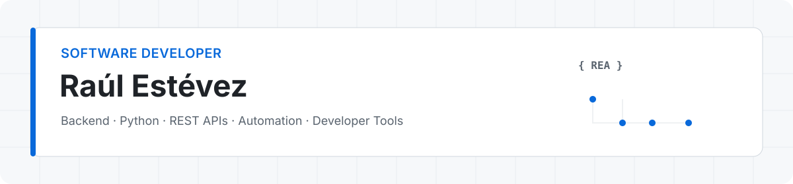

  

  <strong>English</strong> · <a href="./README_es.md">Español</a>

  <a href="https://raulesteveza.github.io/">Portfolio</a> · <a href="https://raulesteveza.github.io/demos/">Live demos</a> · <a href="https://raulesteveza.github.io/tools/">Tools</a> · <a href="https://raulesteveza.github.io/games/">Games</a> · <a href="https://www.linkedin.com/in/raulesteveza/">LinkedIn</a> · <a href="mailto:contact.raulesteveza@gmail.com">Contact</a>

I build backend services, APIs, automation tools and applications that connect systems and turn data into something useful. I care about clear architecture, practical interfaces and software that people can actually run and test.

My main focus is **Python, backend development, REST APIs, data processing and developer tools**. I also build cross-platform applications when the product needs a user-facing client.

## Featured projects

<table>
  <tr>
    <td width="50%" valign="top">
      <h3><a href="https://github.com/RaulEstevezA/Erp_Flutter_Demo">ERP Flutter Integration</a></h3>
      Public rewrite of a production mobile app I built during my DAM internship, together with most of its REST API, to connect field staff with the company's ERP. Includes authentication, six roles and permission-based workflows.  
      <strong>Flutter · Dart · REST · Laravel/PHP · MVVM</strong> 
      <a href="https://raulesteveza.github.io/demos/ERP_Flutter/">Live demo</a> · <a href="https://youtu.be/lrgRXaBEdI4">Product video</a>
    </td>
    <td width="50%" valign="top">
      <h3><a href="https://github.com/RaulEstevezA/Flutter_Shop_Admin_Backend">Flutter Shop Admin Backend</a></h3>
      Reproducible local API environment for a Flutter administration app, with demo data and a one-command Docker Compose setup. The repository distributes the compiled NestJS service rather than the original TypeScript source.  
      <strong>NestJS · PostgreSQL · Docker · REST APIs</strong> 
      <a href="https://github.com/RaulEstevezA/Flutter_Shop_Admin_Backend">Backend</a> · <a href="https://github.com/RaulEstevezA/Flutter_Shop_Admin">Flutter client</a>
    </td>
  </tr>
  <tr>
    <td width="50%" valign="top">
      <h3><a href="https://github.com/RaulEstevezA/Duckyware_Store">DuckyWare Store</a></h3>
      Full e-commerce application with a database-driven catalogue, nested categories, authentication, inventory, carts, wishlists, orders and several payment flows.  
      <strong>Python · Django · SQL · JavaScript</strong> 
      <a href="https://raulesteveza.github.io/demos/Duckyware_Store/">Live demo</a> · <a href="https://github.com/RaulEstevezA/Duckyware_Store">Source</a>
    </td>
    <td width="50%" valign="top">
      <h3><a href="https://github.com/RaulEstevezA/Cinema_App">Cinema App</a></h3>
      Flutter app with TMDB integration, Clean Architecture, API-to-domain mapping and local SQLite favorites.  
      <strong>Flutter · Dart · REST · SQLite · Clean Architecture</strong> 
      <a href="https://raulesteveza.github.io/demos/Cinema_App/">Live demo</a> · <a href="https://github.com/RaulEstevezA/Cinema_App">Source</a>
    </td>
  </tr>
</table>

## Tools

Privacy-first utilities you can use directly in the browser or download for desktop. Data is processed locally and never leaves your device.

<table>
  <tr>
    <td width="50%" valign="top">
      <h3><a href="https://github.com/RaulEstevezA/DataCleanr">DataCleanr</a></h3>
      Clean, normalize and deduplicate CSV, Excel, JSON and XML data. Every proposed change can be reviewed before it is applied.  
      <strong>Python · PySide6 · React · TypeScript</strong> 
      <a href="https://raulesteveza.github.io/tools/DataCleanr/">Try online</a> · <a href="https://github.com/RaulEstevezA/DataCleanr/releases">Desktop releases</a>
    </td>
    <td width="50%" valign="top">
      <h3><a href="https://github.com/RaulEstevezA/Api2Class">Api2Class</a></h3>
      Turn JSON API responses into editable models and generate typed classes for 11 languages, JSON Schema or Smithy.  
      <strong>Python · PySide6 · React · TypeScript</strong> 
      <a href="https://raulesteveza.github.io/tools/Api2Class/">Try online</a> · <a href="https://github.com/RaulEstevezA/Api2Class">Source</a>
    </td>
  </tr>
</table>

Coming next: **[Mapper](https://github.com/RaulEstevezA/Mapper)**, a visual tool for mapping classes, DTOs and data models. [Browse all tools →](https://raulesteveza.github.io/tools/)

## Games

Browser games for playing and for learning SQL and REST APIs. No accounts or backend: progress is saved in the browser.

<table>
  <tr>
    <td width="33%" valign="top">
      <h3><a href="https://github.com/RaulEstevezA/SQL_Detective">SQL Detective</a></h3>
      Solve mysteries by querying fictional databases. 15 bilingual cases, from <code>SELECT</code> to joins, CTEs and window functions, running locally on SQLite + WebAssembly.  
      <strong>JavaScript · SQLite · sql.js · WebAssembly</strong> 
      <a href="https://raulesteveza.github.io/games/SQL_Detective/">Play</a> · <a href="https://github.com/RaulEstevezA/SQL_Detective">Source</a>
    </td>
    <td width="33%" valign="top">
      <h3><a href="https://github.com/RaulEstevezA/API_Quest">API Quest</a></h3>
      Learn REST APIs by building, sending and debugging HTTP requests. 56 bilingual missions across seven chapters, plus a persistent API sandbox.  
      <strong>React · TypeScript · Vite</strong> 
      <a href="https://raulesteveza.github.io/games/API_Quest/">Play</a> · <a href="https://github.com/RaulEstevezA/API_Quest">Source</a>
    </td>
    <td width="33%" valign="top">
      <h3><a href="https://github.com/RaulEstevezA/BlockFall_Python">BlockFall</a></h3>
      Classic falling-block game built from scratch with Python and Pygame, later compiled to WebAssembly for browser play.  
      <strong>Python · Pygame · WebAssembly</strong> 
      <a href="https://raulesteveza.github.io/games/BlockFall_Python/">Play</a> · <a href="https://github.com/RaulEstevezA/BlockFall_Python">Source</a>
    </td>
  </tr>
</table>

[Browse all games →](https://raulesteveza.github.io/games/)

## Technical focus

**Core:** Python · REST APIs · SQL · PostgreSQL · Docker · Git/GitHub 
**Also worked with:** Flutter/Dart · Java · Kotlin · JavaScript/TypeScript · React · NestJS · Django · Laravel · Firebase · Pandas

## More work

- **[CS50 AI](https://github.com/RaulEstevezA/harvard_ai)** — implementations from Harvard's CS50 Introduction to Artificial Intelligence with Python.

## About me

I hold a Higher National Degree in Multiplatform Application Development (DAM) and I am currently studying Computer Engineering at the UOC. My practical training includes building a mobile application and its ERP integration during an internship, as well as independent projects across backend, data tools and cross-platform development.

I have also completed Harvard's CS50, CS50P, CS50W and CS50 AI courses. The coursework is part of my background; the projects above show what I build with it.

## Currently

- Building developer and data tools: **DataCleanr, Api2Class and Mapper**
- Creating educational games for learning SQL and REST APIs
- Working on backend services, APIs, automation and applied AI
- Studying Computer Engineering at the **UOC**
